# notch-utils

<p align="center">
  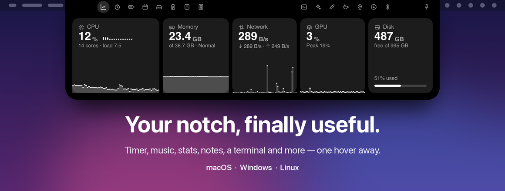
</p>

<p align="center"><b>Your notch, finally useful.</b><br>
A timer, Now Playing, system stats, notes, a terminal and a dozen more tools live in the black
notch at the top of your screen. Hover to peek, click to open, move away and it's gone.</p>

<p align="center">macOS · Windows · Linux · written in Rust with <a href="https://slint.dev">Slint</a> · ~0% CPU while idle</p>

---

## How it feels

<p align="center">
  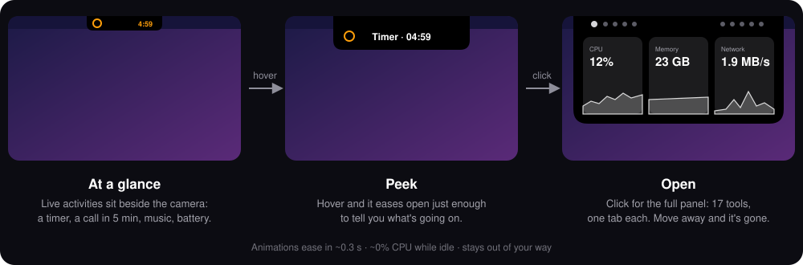
</p>

The notch is already there, eating pixels. notch-utils turns it into the most convenient spot on
your screen:

- **It's always one gesture away.** No window to find, no Dock icon, no Cmd+Tab. Hover the
  notch and it eases open in about 0.3 s; click and you get the full panel.
- **It tells you things before you ask.** A running timer, a meeting about to start, the song
  that's playing, a Claude limit or a low battery show *beside* the camera, while the notch stays
  closed.
- **It disappears when you're done.** Move the mouse away or press Esc and it's a plain notch
  again. Nothing lingers on screen.
- **It feels native.** On a MacBook it sits exactly over the hardware notch, flowing into the
  menu bar with the same corners and shoulders. On Windows,
  Linux and external displays it's a black pill at the top center.
- **It's light.** About 35 MB of memory and ~0% CPU while idle. Every module measures only while
  you're looking at it.

## A tour

| | |
|:---:|:---:|
| 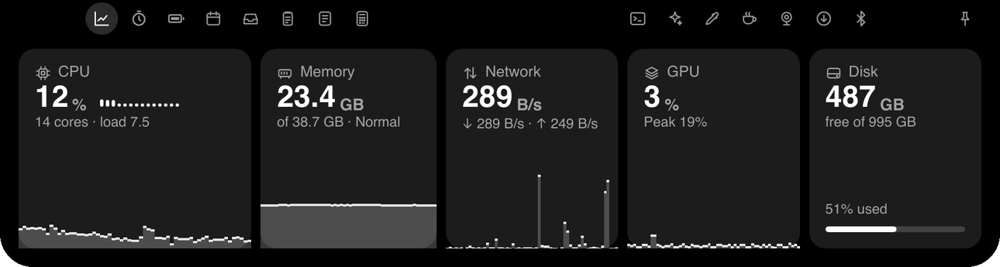<br>**Stats**: CPU, memory, network, GPU and disk with live charts | 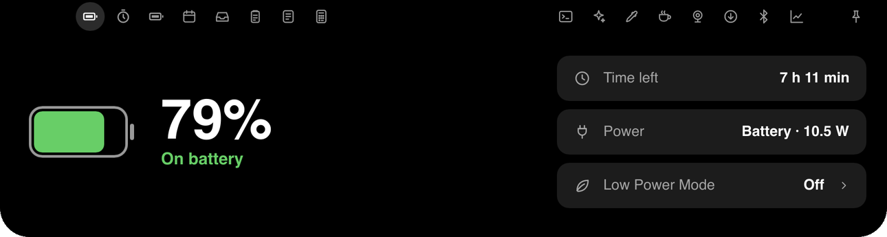<br>**Battery**: charge, time left, power source, Low Power Mode |
| 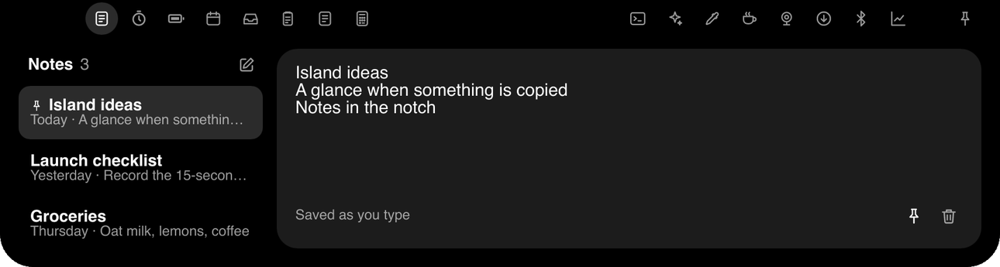<br>**Notes**: jot it down without leaving what you're doing | 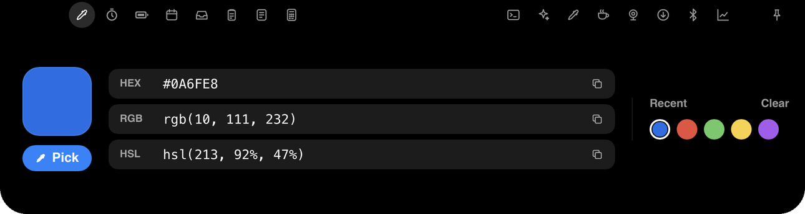<br>**Color Picker**: pick any pixel, copy HEX, RGB or HSL |
| 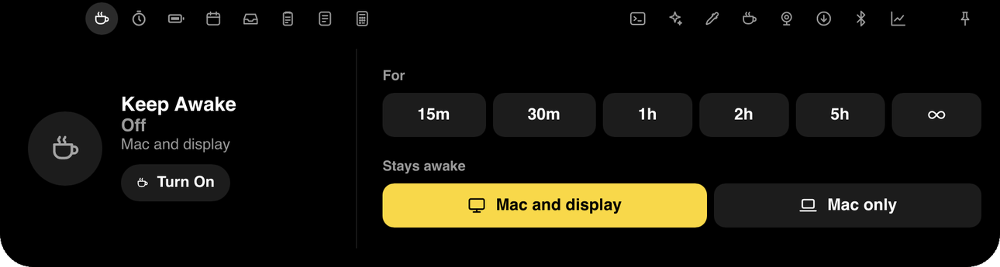<br>**Keep Awake**: for 15 minutes, 5 hours or until you say so | 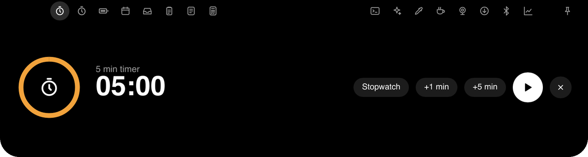<br>**Timer**: countdown or stopwatch, visible while closed |
| 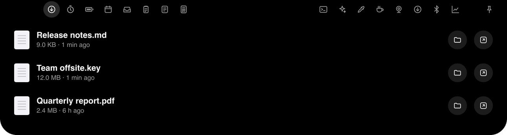<br>**Downloads**: progress, speed and your newest files | 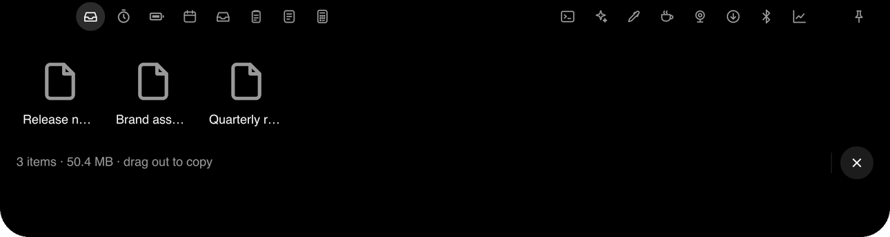<br>**Shelf**: drop files on the notch, drag them out later |
| 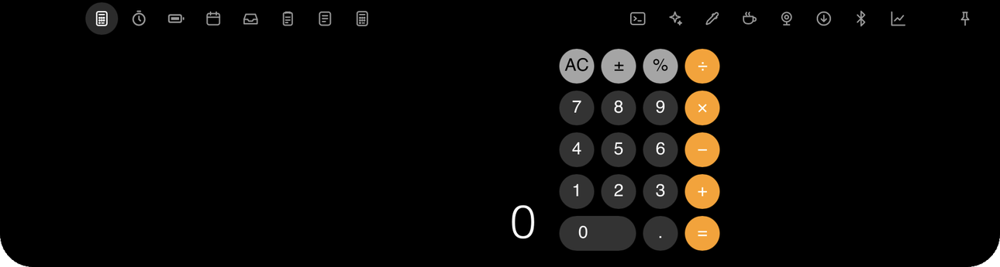<br>**Calculator**: type while the notch is open | **And more**: Home, Now Playing, Calendar with one-click Join, Clipboard history, Terminal, AI usage, Devices, Mirror, status hints and a volume/battery HUD |

## Get it

1. Download the file for your system from the latest [release](../../releases/latest):
   `…-macos-arm64.zip`, `…-windows-x64.zip` or `…-linux-x64.tar.gz` (checksums in
   `SHA256SUMS.txt`). Builds of every commit are also attached to each [CI run](../../actions).
2. macOS: move `notch-utils.app` to Applications, then right-click → Open the first time
   (the build is ad-hoc signed). Windows: run `notch-utils.exe`. Linux: unpack; a `.desktop`
   file is included.
3. Hover the notch. Open **Settings** from the menu-bar icon to pick a module set and turn on
   **Start at login**.

Or build it yourself: `cargo run --release` (see [Build](#build)).

## Use

| Action | How |
|---|---|
| Peek | Hover the notch |
| Open | Click it, press the global hotkey, or run `notch-utils --toggle` |
| Close | Move the mouse away, press Esc, or toggle again |
| Switch tabs | The icons left and right of the camera |
| Settings | Tray / menu-bar icon → Settings…, or `notch-utils --settings` |
| Shelf a file | Drag it onto the notch, or `notch-utils --shelf FILE...` |

Starting `notch-utils` a second time hands the command to the running instance.

## Settings

Everything is in the settings window and in `config.toml`; editing either applies
immediately. The file lives at:

- macOS: `~/Library/Application Support/notch-utils/config.toml`
- Windows: `%APPDATA%\notch-utils\config\config.toml`
- Linux: `~/.config/notch-utils/config.toml`

```toml
[behavior]
open_mode = "peek_then_click"   # peek_then_click | hover_full | click_only
hotkey_enabled = false
hotkey = "Alt+Space"            # e.g. "Ctrl+Alt+Shift+KeyN"
collapse_delay_ms = 300

[display]
target = "main"                 # main | all | follow_mouse

[appearance]
theme = "black"                 # black | system | custom
accent = "#0A84FF"              # used with theme = "custom"
expanded_width = 640
expanded_height = 300
renderer = "software"           # software (~35 MB) | gpu (smoother animations, ~230 MB); restart to apply

[layout]
mode = "tabs"                   # tabs | grid
modules = ["home", "music", "timer", "battery", "calendar", "shelf", "clipboard", "notes",
           "calc", "terminal", "ai", "color", "awake", "mirror", "downloads", "devices",
           "stats", "hud", "hints"]  # tab order; leave out what you don't need

[modules.stats]
view = "graphs"                 # graphs | detailed

[modules.clipboard]
max_entries = 50
persist = false                 # save text history to disk (never images)

[modules.hud]
volume = true
battery = true
[modules.calendar]
urls = []                       # ICS links (https:// or webcal://)
refresh_minutes = 15
```

Missing keys use the defaults. If the file has an error, the app keeps the last good
settings and shows the error in the settings window.

## Modules

Pick a set in Settings (Everyday, Developer, Minimal, Everything) or toggle modules one by one.

- **Now Playing**: what's playing in any app (macOS: system media session, with Music/Spotify
  via AppleScript as fallback; Windows: system media controls; Linux: `playerctl`), with cover,
  progress and controls. macOS asks once for permission to control Music/Spotify.
- **Home**: dashboard with the timer, this week with your next event, battery, Claude usage
  and CPU/RAM.
- **Timer**: countdown and stopwatch; shows in the peek while running, pops the notch
  open when done.
- **Calculator**: macOS-style basic calculator (operator precedence, repeated `=`, `%`).
  Type on the keyboard while the notch is open.
- **Stats**: CPU (per-core bars), memory with pressure, network, GPU (macOS, some Linux) and
  disk, with 60-second charts; a detailed view adds disks, battery, temperatures and top
  processes. Measures only while visible.
- **Battery**: charge, charging state, time to full or empty, adapter wattage (macOS) and Low
  Power Mode (opens the system setting; on Linux it switches power-profiles-daemon directly).
- **Clipboard**: the last 50 copies (text and images), searchable, with pins. Click an
  item to copy it again. Copies marked secret by password managers are never recorded.
  History stays in memory unless you turn on saving (text only, never images).

- **Shelf**: drag files onto the notch to park them. Click one to copy it (then paste in
  Finder/Explorer), drag it out (macOS), show it in its folder or open it. Keeps references
  only, in memory. Also: `notch-utils --shelf FILE...`.
- **Keep Awake**: keep the computer awake for 15 min to 5 h or until turned off, with or
  without the display.
- **Notes**: plain-text notes saved as you type (`notes.json` in the app's data folder). The
  first line is the title; pin the ones you need most.
- **Color Picker**: pick a color anywhere on screen (macOS), copy it as HEX, RGB or HSL, and
  keep your last five picks.
- **Downloads**: downloads in progress (with speed) and your newest files; open, show or drag out.
- **Devices**: connected Bluetooth devices with battery (AirPods left/right/case, Magic
  Trackpad/Keyboard/Mouse). macOS and Linux.
- **Mirror**: your webcam, only while the tab is open.
- **Hints beside the notch**: Caps Lock, connection lost/back and Focus on/off flash briefly;
  microphone/camera in use and offline stay visible. Focus needs Full Disk Access on macOS.
- **Volume & battery HUD**: volume changes, charger plugged/unplugged, full, 20% and 10%
  flash briefly in the notch. No tab of its own.

- **Terminal**: your shell in the notch (zsh/bash/PowerShell), with colors, scrollback and
  full-screen programs like vim. Keeps running while the notch is closed. Esc goes to the
  program; close the notch with the mouse, the hotkey or `--toggle`. Paste: Cmd+V (macOS),
  Ctrl+Shift+V.
- **Calendar**: today's remaining events and tomorrow's from ICS links (Google "Secret
  address in iCal format", iCloud public link, Outlook published calendar). Peeks 15 minutes
  before an event; Home shows a **Join** button when the next event has a Meet, Zoom, Teams,
  Webex or Whereby link. The links are secrets: anyone who has one can read that calendar.
- **AI usage**: your Claude plan's 5-hour and weekly usage (Pro, Max, Ultra), read from
  Claude Code's status line. Click "Connect Claude Code" in the tab once: it adds
  `notch-utils --claude-statusline` to `~/.claude/settings.json` (backup first; an existing
  status line keeps working), and "Disconnect" restores it. Values update while you use
  Claude Code.

## Platform notes

- **Linux** runs through X11/XWayland, because Wayland doesn't let apps position their
  own windows. Global hotkeys don't work on Wayland: bind `notch-utils --toggle` to a
  shortcut in your desktop settings.
- **Follow mouse** display mode currently works on macOS only.
- **Volume HUD on Linux** needs `pactl` (PulseAudio or PipeWire's pulse server). On Windows
  it follows the output device that was default at startup.
- **Dragging files out** of the shelf works on macOS; elsewhere click to copy, then paste.
- Builds are unsigned. On macOS, right-click → Open the first time.
- `vendor/winit` is winit 0.30.13 with one fix for a macOS abort during rapid window
  resizes (marked "notch-utils patch").

## Build

```sh
cargo run --release          # run from source
scripts/bundle-macos.sh      # build target/release/notch-utils.app (+ zip)
```

Linux needs `libfontconfig1-dev libxkbcommon-dev libxkbcommon-x11-dev libdbus-1-dev`.
CI builds all three platforms on every push; binaries are attached to each run as artifacts.

To publish a release, run `scripts/release.sh 0.2.0` on an up-to-date `main`: it sets the
version in `Cargo.toml`, commits, tags `v0.2.0` and pushes. CI then builds macOS, Windows and
Linux and creates the GitHub Release with the packages and checksums attached. A suffix such as
`0.2.0-beta.1` makes a pre-release.

## License

MIT. Slint is used under its Royalty-free Desktop license (see the About section in settings).
